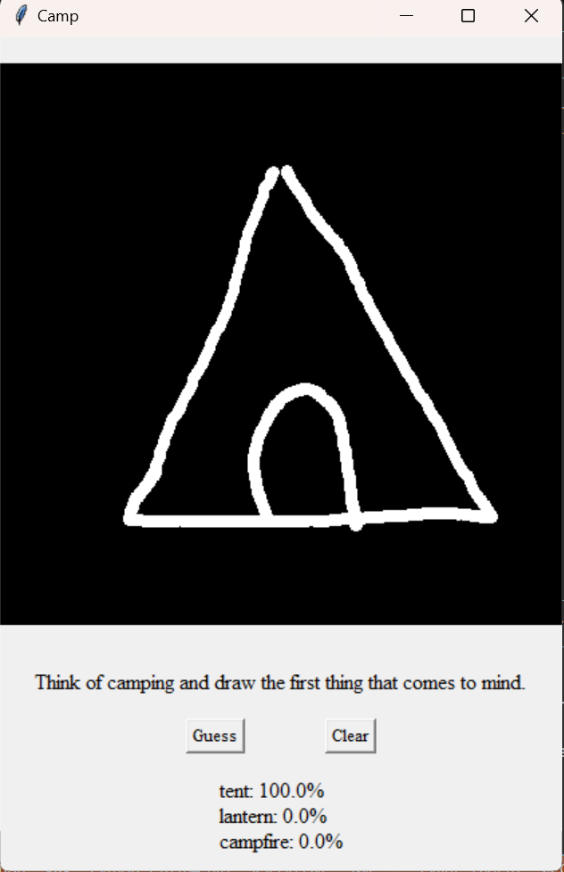
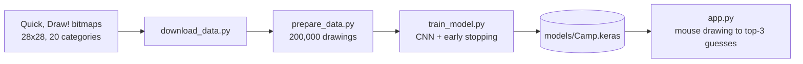
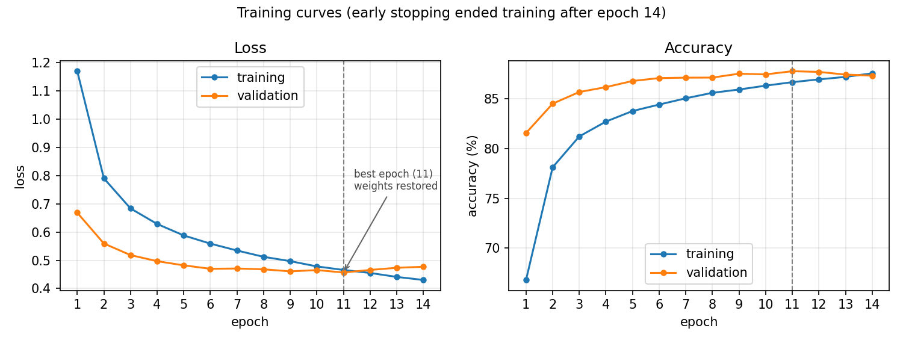
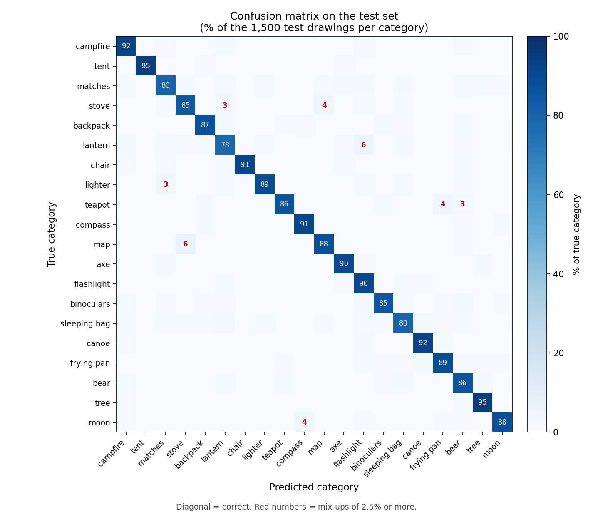

# Camp Doodle


**Draw a camping item with your mouse and a small convolutional neural network (CNN) guesses what it is.**



The app recognizes 20 categories from Google's [Quick, Draw!](https://github.com/googlecreativelab/quickdraw-dataset) dataset and shows its three best guesses with their probabilities. The repository contains the complete pipeline: data download, dataset preparation, model training and evaluation, and the drawing app.

**Categories:** campfire, tent, matches, stove, backpack, lantern, chair, lighter, teapot, compass, map, axe, flashlight, binoculars, sleeping bag, canoe, frying pan, bear, tree, moon

## Quick start

A trained model is included, so you can try the app without downloading data or training anything:

```
pip install -r requirements.txt
python app.py
```

Draw one item on the black canvas and press **Guess** to see the top 3 predictions. Press **Clear** to start over.

## Highlights

- **End-to-end pipeline:** raw bitmaps, a reproducible train/validation/test split, a CNN with early stopping, evaluation, and an interactive app.
- **Decisions based on data, not guesses:** the categories were chosen after the confusion matrix of a first version showed which shapes get mixed up, and the preprocessing of mouse drawings was tuned by measuring the training images (see [Design notes](#design-notes)).
- **Honest evaluation:** the test set is used once, and the [limitations](#limitations-and-future-work) are documented.

## How it works



| File | What it does |
|---|---|
| `config.py` | The list of categories. Its order defines the class labels, so never reorder it after training. |
| `download_data.py` | Downloads the Quick, Draw! 28x28 bitmap file of every category into `data/`. Finished files are skipped. |
| `prepare_data.py` | Takes the first 10,000 drawings of every category and saves them as `features.npy` and `labels.npy`. |
| `train_model.py` | Splits the data, trains the CNN with early stopping, saves it to `models/Camp.keras` and prints the test accuracy and confusion matrix. |
| `app.py` | Tkinter app: a 420x420 canvas with an 8 px pen, a **Guess** and a **Clear** button. |

## Dataset

- Source: Quick, Draw! numpy bitmaps (28x28 grayscale, white strokes on a black background).
- 10,000 drawings per category, 200,000 in total (the first 10,000 of each file, not a random sample).
- Stratified split with a fixed seed: 136,000 drawings for training, 34,000 for validation and 30,000 for testing (1,500 per category).
- Pixel values are scaled from 0-255 to 0-1.

## Model

| Layer | Output shape | Parameters |
|---|---|---|
| Conv2D (32 filters, 3x3, ReLU) | 26 x 26 x 32 | 320 |
| MaxPooling2D (2x2) | 13 x 13 x 32 | 0 |
| Conv2D (64 filters, 3x3, ReLU) | 11 x 11 x 64 | 18,496 |
| MaxPooling2D (2x2) | 5 x 5 x 64 | 0 |
| Flatten | 1,600 | 0 |
| Dense (128, ReLU) | 128 | 204,928 |
| Dropout (0.5) | 128 | 0 |
| Dense (20, softmax) | 20 | 2,580 |

**Total: 226,324 parameters.** Training uses Adam, sparse categorical cross-entropy, batch size 64 and at most 30 epochs. Early stopping watches the validation loss (patience 3) and restores the best weights.



In my run the validation loss was lowest at epoch 11 (0.4568, validation accuracy 87.78%). After that it started to rise while the training loss kept falling, and training stopped after epoch 14. The two accuracy curves stay close together, so overfitting is small. (Training accuracy is measured with dropout switched on, which is why it starts below the validation accuracy.) Training takes roughly 7 minutes on a CPU.

## Results

The final model reaches **87.86%** accuracy on the 30,000 held-out test drawings, compared with 5% for random guessing among 20 categories.



Accuracy per category, computed from the confusion matrix (1,500 test drawings each):

| Category | Accuracy | Most common wrong guess |
|---|---|---|
| tree | 94.9% | bear (18) |
| tent | 94.5% | - |
| canoe | 92.5% | flashlight (25) |
| campfire | 92.3% | lantern (24) |
| chair | 91.1% | matches (20) |
| compass | 91.1% | backpack (28) |
| flashlight | 90.3% | sleeping bag (19) |
| axe | 89.9% | matches (34) |
| lighter | 88.7% | matches (49) |
| frying pan | 88.5% | canoe (28) |
| moon | 88.1% | compass (57) |
| map | 87.7% | stove (94) |
| backpack | 87.4% | lantern (31) |
| teapot | 86.1% | frying pan (53) |
| bear | 85.7% | tree (28) |
| binoculars | 85.2% | bear (32) |
| stove | 84.6% | map (67) |
| sleeping bag | 80.3% | lantern (37) |
| matches | 79.9% | stove (31), flashlight (29) |
| lantern | 78.3% | flashlight (92) |

The largest confusions are map and stove (94 and 67 mix-ups), lantern guessed as flashlight (92), moon guessed as compass (57), teapot guessed as frying pan (53) and lighter guessed as matches (49). I have not yet looked at the misclassified drawings, so I make no claim about why these pairs get mixed up.

## Design notes

### Why camping?

The first version of this project recognized nine sea creatures and reached 83.6% test accuracy. Its confusion matrix showed that animals with similar silhouettes were mixed up (dolphin, shark and whale; crab and lobster). I replaced them with a set of visually more distinct objects, and accuracy rose to 87.86% even though the task now has twice as many categories.

### From mouse to model

A mouse drawing looks different from a Quick, Draw! bitmap, so `app.py` preprocesses it before the CNN sees it:

1. Crop the drawing to its bounding box.
2. Thicken the strokes of larger drawings so that the stroke width is proportional to the drawing size (roughly 8% of its longest side, about 2 px after scaling).
3. Center the drawing in a square so that its longest side fills about 26 of the 28 pixels.
4. Resize to 28x28 (Lanczos), scale to 0-1 and feed it to the model.

The numbers in steps 2 and 3 come from measuring the training data (median longest side of tent, matches and map drawings: 26 px). They were needed because my first version only resized the drawing: large drawings then shrank to faint hairlines, and a big tent drawing was guessed as "matches" with only 24% confidence. After measuring the training images and scaling the stroke width, the guesses in my manual tests improved.

## Limitations and future work

- **Closed set:** the model always answers with one of the 20 categories, even if you draw something else.
- **Mouse vs. Quick, Draw!:** the 87.86% is measured on Quick, Draw! test drawings. I have not evaluated the model systematically on my own mouse drawings, only tested it by hand, so the accuracy in the app can differ.
- **Similar shapes** are mixed up (see the table above).
- Only the first 10,000 drawings of each category are used, and Quick, Draw! is crowd-sourced, so some drawings are noisy.
- Top-3 accuracy is not reported yet, although the app shows three guesses.

Ideas for improvement: measure accuracy on mouse drawings, inspect the misclassified samples, add data augmentation (small shifts and rotations), try a deeper CNN, and reject low-confidence guesses.

## Reproduce the results

Tested with Python 3.10 on Windows. Run every command from the project folder, because the data and model paths are relative.

```
pip install -r requirements.txt
python download_data.py
python prepare_data.py
python train_model.py
python app.py
```

- `download_data.py` downloads one file per category, a few GB in total. Finished files are skipped, so it is safe to re-run.
- `prepare_data.py` skips itself if `data/features.npy` and `data/labels.npy` already exist. Delete them to rebuild the dataset, for example after changing the categories.
- `train_model.py` uses seed 50 for the data split and the weight initialization. Results on another machine or TensorFlow version may differ slightly.
- To use other categories, edit the list in `config.py` (the names must match the Quick, Draw! category names) and repeat all steps.

## Project structure

```
.
├── app.py
├── config.py
├── download_data.py
├── prepare_data.py
├── train_model.py
├── requirements.txt
├── models/
│   └── Camp.keras
└── docs/
    ├── screenshot.png
    ├── training_curves.png
    └── confusion_matrix.png
```

## Acknowledgements

The drawings come from the [Quick, Draw! dataset](https://github.com/googlecreativelab/quickdraw-dataset) by Google, licensed under [CC BY 4.0](https://creativecommons.org/licenses/by/4.0/).
